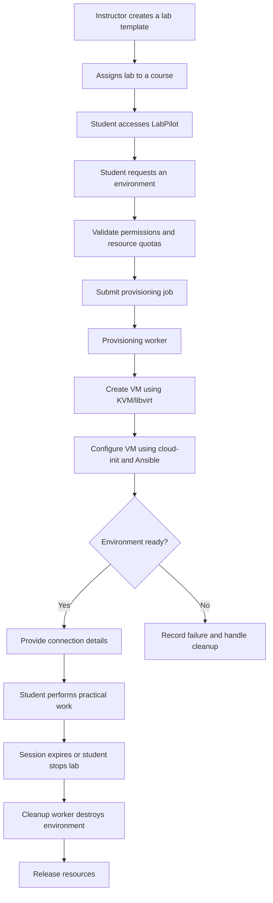
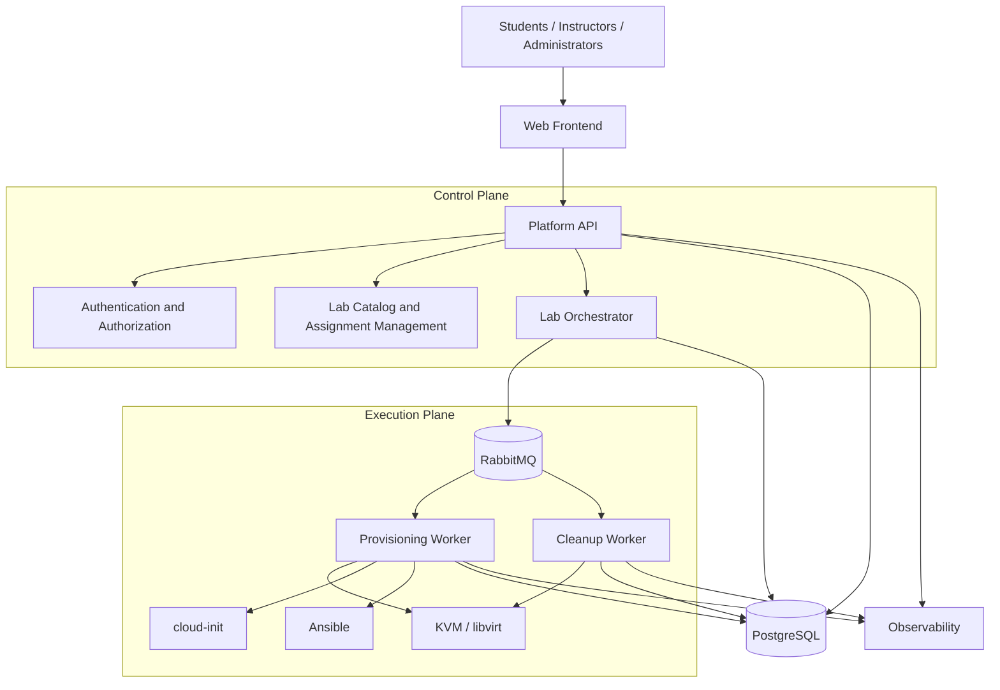

# 🚀 LabPilot

### Self-Hosted Platform for Automated Provisioning and Management of Educational Lab Environments

[]()
[]()
[]()
[]()
[]()

**LabPilot** is a self-hosted platform designed to simplify and automate the creation, provisioning, distribution, monitoring, and lifecycle management of practical computing environments for universities, colleges, training centers, and educational institutions.

Instead of manually preparing virtual machines and configuring environments for every practical session, instructors can publish reusable lab templates and students can launch their own isolated environments on demand.

LabPilot automates the complete lab lifecycle — from provisioning to cleanup — while applying modern **DevOps, Infrastructure as Code, Microservices, and DevSecOps principles**.

---

## 📌 Table of Contents

- [The Problem](#-the-problem)
- [The Solution](#-the-solution)
- [Key Features](#-key-features)
- [How It Works](#-how-it-works)
- [Target Users](#-target-users)
- [Architecture](#-architecture)
- [Technology Stack](#-technology-stack)
- [Lab Environment Examples](#-lab-environment-examples)
- [Development Roadmap](#-development-roadmap)
- [Getting Started](#-getting-started)
- [Project Structure](#-project-structure)
- [DevOps and DevSecOps Strategy](#-devops-and-devsecops-strategy)
- [Project Objectives](#-project-objectives)
- [Contributing](#-contributing)
- [License](#-license)

---

## 🎯 The Problem

Practical computing courses often require students to work with specific operating systems, software, tools, and network configurations.

Preparing and maintaining these environments can be challenging:

- **Manual provisioning:** Instructors or administrators must prepare virtual machines and install required tools.
- **Environment inconsistency:** Students may work with different operating systems, versions, configurations, and dependencies.
- **Limited resources:** Institutional computer labs have finite hardware and virtualization capacity.
- **Time-consuming maintenance:** Broken environments must be repaired or recreated manually.
- **Difficult distribution:** Providing students with access to individual environments can require significant administrative effort.
- **Resource waste:** Virtual machines may remain running long after practical sessions have ended.
- **Limited visibility:** Administrators may lack a centralized view of active environments and resource consumption.

These challenges reduce the time available for teaching and learning.

## 💡 The Solution

LabPilot introduces a centralized, self-service platform that automates educational lab environments.

Teachers define reusable lab templates and assign them to students or courses. Students can then request an environment through the platform without manually configuring the underlying infrastructure.

LabPilot handles:

1. Lab template management.
2. Environment provisioning.
3. Automated machine configuration.
4. Student access management.
5. Session and resource monitoring.
6. Environment reset and reuse.
7. Automatic expiration and cleanup.

The platform aims to make practical environments **reproducible, isolated, accessible, and manageable**.

---

## ✨ Key Features

### Student Portal

- Browse available and assigned practical labs.
- Launch an environment on demand.
- View provisioning and session status.
- Retrieve connection information.
- Access environments through SSH (initial implementation).
- Reset or stop an environment.
- View session expiration information.

### Instructor Dashboard

- Create and manage lab templates.
- Configure CPU, memory, storage, and session limits.
- Assign practical labs to courses and student groups.
- Monitor student environment availability.
- Track provisioning failures and session status.

### Administration

- Manage users, roles, and permissions.
- Manage virtualization infrastructure.
- Monitor active environments and resource consumption.
- Define resource quotas and provisioning policies.
- Inspect provisioning jobs and system logs.
- Configure automatic expiration and cleanup policies.

### Infrastructure Automation

- Automated virtual machine provisioning.
- Cloud-init based initial configuration.
- Ansible-based environment configuration.
- Reusable lab templates.
- Asynchronous provisioning jobs.
- Automatic environment cleanup.
- Failure handling and provisioning retries.

---

## 🔄 How It Works

A typical LabPilot workflow:



### Example: Launching a Linux Networking Lab

1. An instructor publishes a `linux-networking-101` template.
2. A student opens the assigned practical and clicks **Start Lab**.
3. LabPilot validates the student's permissions and available infrastructure capacity.
4. A provisioning job is added to the message queue.
5. A worker creates an Ubuntu virtual machine using KVM/libvirt.
6. Cloud-init and Ansible configure the environment.
7. LabPilot verifies that the VM is ready.
8. The student receives SSH connection details.
9. The student completes the practical.
10. The environment is automatically destroyed when its session expires.

---

## 🏗 Architecture

LabPilot follows a modular, asynchronous microservices-oriented architecture.

The architecture separates the platform's control plane from infrastructure provisioning operations.

### High-Level Architecture



### Main Components

| Component | Responsibility |
|---|---|
| Web Frontend | Student, instructor, and administrator interfaces |
| Platform API | Main application interface and business operations |
| Authentication | User authentication and role-based access |
| Lab Catalog | Lab templates and course assignments |
| Lab Orchestrator | Environment lifecycle and provisioning coordination |
| Message Broker | Asynchronous communication and job distribution |
| Provisioning Worker | Virtual machine creation and configuration |
| Cleanup Worker | Session expiration and resource cleanup |
| PostgreSQL | Persistent application data |
| Observability | Metrics, logs, and operational monitoring |

> The architecture will evolve during development. Services may initially be implemented as modular components and separated into independently deployable services when justified.

---

## 🛠 Technology Stack

The following technologies are proposed for the project. Their adoption may evolve as implementation progresses.

| Category | Technologies |
|---|---|
| Frontend | React / Next.js |
| Backend | Node.js / TypeScript |
| API | REST API |
| Database | PostgreSQL |
| Message Broker | RabbitMQ |
| Containerization | Docker |
| Container Orchestration | Docker Compose, Kubernetes |
| Virtualization | KVM / libvirt |
| VM Configuration | cloud-init |
| Configuration Management | Ansible |
| Reverse Proxy | Nginx / Traefik |
| CI/CD | GitHub Actions / GitLab CI |
| Infrastructure as Code | Terraform / OpenTofu (future) |
| Monitoring | Prometheus |
| Dashboards | Grafana |
| Logging | Loki (planned) |
| Security Scanning | Trivy |
| GitOps | Argo CD (planned) |

---

## 🧪 Lab Environment Examples

LabPilot is intended to support different categories of computing practicals.

| Category | Example practicals |
|---|---|
| Linux Administration | Users, permissions, systemd, SSH, networking |
| Networking | IP addressing, routing, DNS, firewall configuration |
| Docker | Images, containers, volumes, networks, Compose |
| Kubernetes | Pods, Deployments, Services, Ingress, namespaces |
| CI/CD | Pipeline creation, testing, building, deployment |
| Infrastructure Automation | Ansible, cloud-init, infrastructure provisioning |
| Cloud Computing | Virtual machines and cloud infrastructure fundamentals |

Initially, the platform will focus on predefined Linux-based VM templates. Additional environment providers and lab types can be introduced progressively.

---

## 🗺 Development Roadmap

LabPilot will be developed incrementally, prioritizing a functional end-to-end workflow before introducing advanced capabilities.

### Phase 1 — Core MVP

- [ ] Define initial architecture and database model.
- [ ] Implement user authentication and roles.
- [ ] Implement lab template management.
- [ ] Implement student lab requests.
- [ ] Integrate KVM/libvirt.
- [ ] Implement automated VM provisioning.
- [ ] Integrate cloud-init and Ansible.
- [ ] Provide SSH connection details.
- [ ] Implement lab status tracking.
- [ ] Implement stop, reset, and destroy operations.
- [ ] Implement session expiration and automatic cleanup.

### Phase 2 — Educational Features

- [ ] Course and class management.
- [ ] Instructor dashboard.
- [ ] Student lab assignments.
- [ ] Resource quotas and capacity checks.
- [ ] Lab usage history.
- [ ] Provisioning job history and error reporting.
- [ ] Browser-based terminal access.
- [ ] Reusable and versioned lab templates.

### Phase 3 — DevOps and Observability

- [ ] Containerize all platform components.
- [ ] Implement automated CI pipelines.
- [ ] Automate application deployment.
- [ ] Integrate Prometheus and Grafana.
- [ ] Centralize application and worker logs.
- [ ] Add health checks and service monitoring.
- [ ] Add automated integration and end-to-end tests.
- [ ] Implement deployment rollback procedures.

### Phase 4 — DevSecOps and Advanced Infrastructure

- [ ] Integrate Trivy vulnerability scanning.
- [ ] Improve secrets management.
- [ ] Implement audit logging.
- [ ] Harden provisioning workers and VM isolation.
- [ ] Deploy the platform to Kubernetes.
- [ ] Integrate Helm and Argo CD.
- [ ] Support multiple virtualization hosts.
- [ ] Introduce capacity-aware scheduling.
- [ ] Explore additional infrastructure providers.

---

## 🚀 Getting Started

> **Development status:** LabPilot is currently in the planning / initial development stage. The instructions below describe the intended development environment and will be updated as implementation becomes available.

### Prerequisites

For the initial infrastructure development environment:

- Linux host with KVM support.
- KVM and libvirt.
- `virsh` command-line utility.
- Cloud-init compatible VM images.
- Ansible.
- Docker and Docker Compose.
- Git.
- Node.js (if using the proposed backend/frontend stack).

### Clone the repository

```bash
git clone https://github.com/YOUR_USERNAME/labpilot.git
cd labpilot
```

### Development environment

The intended local development environment will use Docker Compose to run the application services and their dependencies.

```bash
docker compose up -d
```

Actual installation and startup instructions will be provided once the initial implementation and configuration files are available.

---

## 📁 Project Structure

Proposed repository structure:

```text
labpilot/
│
├── frontend/
│   ├── src/
│   ├── public/
│   └── Dockerfile
│
├── services/
│   ├── platform-api/
│   ├── lab-orchestrator/
│   ├── provisioning-worker/
│   └── cleanup-worker/
│
├── infrastructure/
│   ├── docker/
│   ├── kubernetes/
│   ├── ansible/
│   ├── cloud-init/
│   └── libvirt/
│
├── templates/
│   ├── linux-networking-101/
│   ├── docker-basics/
│   └── kubernetes-basics/
│
├── docs/
│   ├── architecture/
│   ├── diagrams/
│   ├── api/
│   └── decisions/
│
├── scripts/
│
├── docker-compose.yml
├── .env.example
├── .gitignore
└── README.md
```

The actual repository structure may change as services and infrastructure responsibilities become clearer.

---

## 🔐 DevOps and DevSecOps Strategy

DevOps and DevSecOps are core engineering principles of LabPilot, not just technologies added to the project.

The project aims to demonstrate:

- **Continuous Integration:** Automated validation, testing, and building on every code change.
- **Continuous Delivery:** Reproducible application releases and automated deployments.
- **Infrastructure as Code:** Version-controlled infrastructure and lab definitions.
- **Configuration Management:** Automated environment configuration using Ansible.
- **Containerization:** Consistent packaging and deployment of platform components.
- **Orchestration:** Automated service and infrastructure lifecycle management.
- **Observability:** Centralized metrics, logs, and operational visibility.
- **Security Automation:** Image scanning, access control, secrets protection, and security checks.
- **Reliability:** Retry mechanisms, health checks, failure handling, and automated cleanup.
- **GitOps:** Version-controlled desired state and automated reconciliation of deployments.

### Security considerations

Because students may execute arbitrary commands inside their practical environments, LabPilot must consider isolation and access control from the beginning.

Key security requirements include:

- Isolated lab environments.
- Strict CPU, memory, disk, and session quotas.
- Role-based access control.
- Restricted student access to infrastructure management interfaces.
- Secure handling of credentials and secrets.
- Controlled network connectivity between environments.
- Audit trails for administrative actions.
- Hardened provisioning workers and minimal infrastructure privileges.

---

## 🎓 Project Objectives

The main objectives of LabPilot are:

1. Design and develop a self-hosted educational lab management platform.
2. Automate virtual machine provisioning and configuration.
3. Provide reusable and reproducible practical environments.
4. Implement an asynchronous, modular architecture.
5. Apply containerization and CI/CD practices.
6. Integrate Infrastructure as Code and configuration management.
7. Implement monitoring, logging, and failure handling.
8. Introduce DevSecOps practices throughout the development lifecycle.
9. Explore Kubernetes and GitOps for advanced platform deployment.

### Expected Results

The project will be evaluated using measurable criteria such as:

- Time required to provision a lab.
- Successful provisioning rate.
- Environment reproducibility after reset.
- Correct cleanup after session expiration.
- Resource consumption per active lab.
- Recovery behavior after provisioning failures.
- Application deployment and pipeline reliability.

---

## 🤝 Contributing

Contributions, suggestions, bug reports, and architectural discussions are welcome.

If you would like to contribute:

1. Fork the repository.
2. Create a feature branch.
3. Implement your changes.
4. Add or update tests.
5. Submit a pull request.

For major architectural changes, consider opening an issue or proposing an Architecture Decision Record (ADR) first.

---

## 📄 License

The project license has not yet been selected. Licensing details will be added before the first public release.

---

## 👨‍💻 Author

**LabPilot** — A DevOps and platform engineering graduation project focused on automating educational computing environments.

Built with a focus on automation, reproducibility, infrastructure management, and modern DevOps practices.

---

⭐ If you find the project interesting, consider starring the repository and following its development.
